<p align="center">
  <picture>
    <source media="(max-width: 640px)" srcset="assets/header-narrow.svg">
    
  </picture>
</p>

<p align="center">
  this is byte. byte lives here now.<br>
  byte gets hungry, bored and sleepy whether anyone visits or not.
</p>

<p align="center">
  <picture>
    <source media="(max-width: 640px)" srcset="assets/byte-narrow.svg">
    
  </picture>
</p>

<p align="center">
  <a href="https://github.com/kheif/kheif/issues/new?title=byte%7Cfeed&body=submit%20this%20and%20byte%20gets%20a%20fish.%20takes%20about%20a%20minute."></a>&nbsp;
  <a href="https://github.com/kheif/kheif/issues/new?title=byte%7Cplay&body=submit%20this%20and%20byte%20gets%20the%20yarn.%20takes%20about%20a%20minute."></a>&nbsp;
  <a href="https://github.com/kheif/kheif/issues/new?title=byte%7Cpet&body=submit%20this%20and%20byte%20gets%20pet.%20takes%20about%20a%20minute."></a>
</p>

<p align="center"><sub>each button opens an issue. submit it, byte reacts in about a minute and writes back.</sub></p>

<p align="center">
<!-- BYTE:START -->
<sub>nobody yet.</sub>
<!-- BYTE:END -->
</p>

<details>
<summary>byte's diary</summary>

<!-- DIARY:START -->
```text
nov 05  nobody came. i stared at the bowl until it got dark.
nov 04  moved in today. the rug is acceptable.
```
<!-- DIARY:END -->

</details>

<br>

<p align="center">
  <sub>
    elsewhere: <a href="https://linkedin.com/in/kheif">linkedin</a> · <a href="https://youtube.com/@kheifs">youtube</a> · <a href="https://medium.com/@kheif">medium</a>
    <br>
    tea money: <a href="https://buymeacoffee.com/kheif">buy me a coffee</a> · <a href="https://paypal.me/kheif">paypal</a> <i>(byte gets a cut)</i>
  </sub>
</p>
