<p align="center">
  
</p>

<h3 align="center">🐈 Meet Byte, the official cat of this profile</h3>

<p align="center">
  Byte lives here. Byte gets <b>hungry</b>, <b>bored</b> and <b>sleepy</b> while you are away,<br>
  and Byte only trusts strangers from the internet to take care of it. That means <b>you</b>.
</p>

<p align="center">
  
</p>

<p align="center">
  <a href="https://github.com/kheif/kheif/issues/new?title=byte%7Cfeed&body=Just%20hit%20%2A%2ACreate%2A%2A%20and%20Byte%20gets%20a%20fish%20within%20a%20minute%21%20%F0%9F%90%9F%0A%0A%28you%20can%20leave%20Byte%20a%20little%20note%20here%20if%20you%20want%29"></a>
  &nbsp;
  <a href="https://github.com/kheif/kheif/issues/new?title=byte%7Cplay&body=Just%20hit%20%2A%2ACreate%2A%2A%20and%20Byte%20gets%20the%20yarn%20ball%20within%20a%20minute%21%20%F0%9F%A7%B6%0A%0A%28you%20can%20leave%20Byte%20a%20little%20note%20here%20if%20you%20want%29"></a>
  &nbsp;
  <a href="https://github.com/kheif/kheif/issues/new?title=byte%7Cpet&body=Just%20hit%20%2A%2ACreate%2A%2A%20and%20Byte%20gets%20head%20scritches%20within%20a%20minute%21%20%F0%9F%A4%97%0A%0A%28you%20can%20leave%20Byte%20a%20little%20note%20here%20if%20you%20want%29"></a>
</p>

<p align="center"><sub>click a button, press <b>Create</b>, wait about a minute, refresh. Byte will reply to you personally (Byte is very polite).</sub></p>

<table align="center"><tr><td align="center">
<b>💌 Byte's latest besties</b><br><br>
<!-- BYTE:START -->
<i>nobody yet. be the first one!</i>
<!-- BYTE:END -->
</td></tr></table>

<br>

<h3 align="center">🎁 Mystery boxes</h3>
<p align="center"><sub>go on, open them. nobody is watching.</sub></p>

<details>
<summary><b>📦 Box #1</b> &nbsp;what is this human doing these days?</summary>
<br>

```js
const mehmet = {
  location:  "somewhere between a terminal and a tea glass",
  doing:     "software stuffs 🛠️",
  learning:  "whatever broke yesterday",
  fuel:      ["çay", "çay", "more çay", "coffee (emergencies only)"],
  bugs:      Infinity,
  vibe:      "it works on my machine ✨",
};
```

</details>

<details>
<summary><b>📦 Box #2</b> &nbsp;where can I find this human?</summary>
<br>
<p align="center">
  <a href="https://linkedin.com/in/kheif"></a>
  <a href="https://youtube.com/@kheifs"></a>
  <a href="https://medium.com/@kheif"></a>
</p>
</details>

<details>
<summary><b>📦 Box #3</b> &nbsp;a tiny gift for you</summary>
<br>
<p align="center">
  You found a cookie. 🍪<br>
  It is a virtual cookie, so it has zero calories.<br>
  <sub>(Byte tried to eat it. Byte was not allowed.)</sub>
</p>
</details>

<details>
<summary><b>📦 Box #4</b> &nbsp;⚠️ do NOT open this one</summary>
<br>
<p align="center">
  ...you opened it. of course you did. 😼<br>
  I respect that. curiosity is how all good software starts.<br>
  <sub>now go feed Byte, it is probably hungry again.</sub>
</p>
</details>

<br>

<h3 align="center">☕ Keep the human (and the cat) running</h3>

<p align="center">
  <a href="https://buymeacoffee.com/kheif"></a>
  <a href="https://paypal.me/kheif"></a>
</p>

<p align="center"><sub>thanks for stopping by. Byte says <i>mrrp</i>. 🐾</sub></p>
